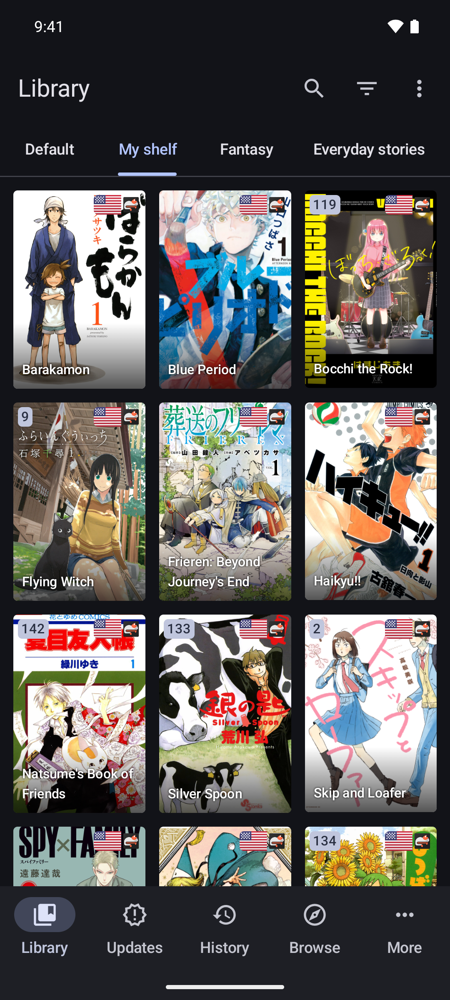
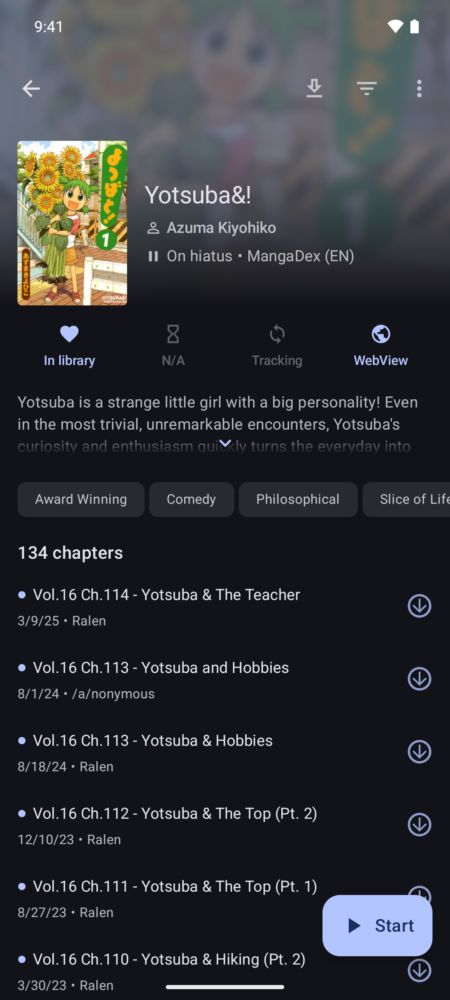
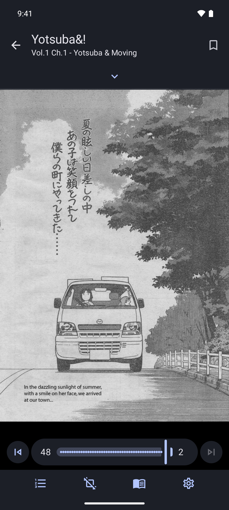
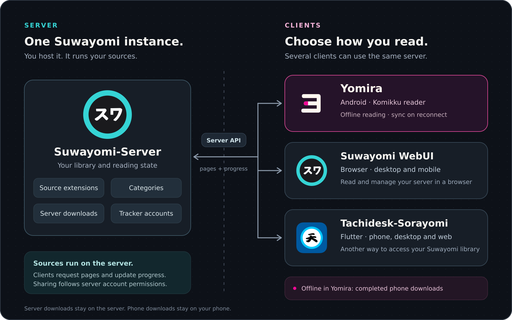

  

<h1 align="center">Yomira</h1>

  <strong>Komikku's Android reading experience, connected to your Suwayomi library.</strong>

  A free, open source Android client for <a href="https://github.com/Suwayomi/Suwayomi-Server">Suwayomi-Server</a>,
  forked from <a href="https://github.com/komikku-app/komikku">Komikku</a>. 
  Keep the familiar library and reader on your phone while your server handles sources, library updates, and tracking.

  <strong>Requires Android 8.0+ and a Suwayomi server.</strong> 
  Completed phone downloads can be read without the server.

  <a href="https://github.com/MathisVerstrepen/Yomira/releases/latest"><strong>Download APK</strong></a>
  · <a href="#get-started">Get started</a>
  · <a href="#compare-the-clients">Compare clients</a>
  · <a href="./docs/USAGE.md">User guide</a>

## A look inside

  
  
  

## What you can do

- **Read with Komikku's reader:** page and webtoon modes, gestures, themes, bookmarks, and chapter controls.
- **Keep your Suwayomi library with you:** categories, search, filters, bulk actions, updates, and reading history.
- **Browse server sources:** search across providers and manage server extensions from Browse.
- **Migrate providers:** find replacement titles, review chapter matches, and transfer progress, bookmarks, and categories. Start from **Browse → Migrate** or a library title’s **More → Migrate** menu.
- **Read offline:** download chapters to your phone, with Wi-Fi-only transfers and a storage limit. Reading progress synchronizes after reconnecting.
- **Manage your server:** control its download queue, configure library updates, and connect tracker accounts.

## How it works

- **Server:** runs source extensions and stores the library, progress, categories, trackers, and server downloads.
- **Yomira:** provides the Android interface and reader, streams pages from the server, and saves phone downloads locally.
- **Other clients:** WebUI and Sorayomi can use the same server. What they share depends on the server's account model and permissions.

**Downloading on the server does not download to your phone.** Choose **Download to phone** for offline reading. [More about the architecture →](./docs/ARCHITECTURE.md)

## Compare the clients

Choose Komikku for a standalone Android library, Yomira for Komikku's reader with Suwayomi, Sorayomi for a client across several platforms, or WebUI for browser access.

| Feature | Original [Komikku](https://github.com/komikku-app/komikku) | [Tachidesk-Sorayomi](https://github.com/Suwayomi/Tachidesk-Sorayomi) | [Suwayomi WebUI](https://github.com/Suwayomi/Suwayomi-WebUI) | **Yomira** |
| --- | --- | --- | --- | --- |
| Platforms | Android | Android, iOS, desktop, web | Desktop/mobile browser | **Android 8.0+** |
| Reader/interface | Native Komikku | Flutter | Browser | **Komikku-based Android UI** |
| Suwayomi server required | No | Yes | Yes | Yes |
| Main library and progress | On the phone | On Suwayomi | On Suwayomi | On Suwayomi |
| Source extensions run on | Phone | Server | Server | Server |
| Search across sources | Yes | Yes | Yes | Yes |
| Manage server downloads | Not a full server client | Yes | Yes | Yes |
| Offline reading from device downloads | Local downloads; no server needed | No¹ | No¹ | **Completed phone downloads** |
| Tracker account management | On the phone | No built-in UI | Through the server | Through the server |
| Source migration | Yes | Yes | Yes | **Chapter review and verified transfer** |

¹ Sorayomi and WebUI cache reader images, but their download actions save chapters **on the server**. Neither provides managed offline chapter downloads to the reading device.

## Get started

1. **Install Yomira** from [Releases](https://github.com/MathisVerstrepen/Yomira/releases/latest). Choose the **universal APK** if unsure.
2. **Prepare your server.** Set up [Suwayomi-Server](https://github.com/Suwayomi/Suwayomi-Server), install source extensions there, and select your browsing languages/providers in WebUI.
3. **Connect.** Enter the full server URL, including any proxy path. Choose the matching sign-in method and enter credentials if needed. Use HTTPS outside a trusted network.
4. **Open your library**, or find titles in **Browse**. Server extension management is also in Browse.

Already using **Komikku Suwayomi**? Install a newer release signed by this fork over your existing release to keep app data. Yomira retains this fork's package identity. [Connection options and compatibility →](./docs/USAGE.md#connect-to-a-server)

## Take chapters offline

1. Open a title, select chapters, and choose **Download to phone**.
2. Check **More → Phone downloads**. The defaults are **Wi-Fi only** and a **2 GiB storage limit**; both are configurable.
3. Wait for **Available offline**, then read without the server. Progress and bookmarks synchronize when you reconnect.

Server and phone icons show where each copy is stored. Tap a chapter's download icon to choose another destination. [Offline storage, retries, and account changes →](./docs/USAGE.md#read-offline)

## Move titles to another provider

Open **Browse → Migrate**, choose a library provider, and select titles. Pick a replacement provider or **Search all providers**, choose a title, and review its chapter matches before transferring.

**Keep original in library** is off by default. The original is removed from the library only after the selected data is verified on the replacement. Turn the option on to retain both entries. Downloads stay with the original entry. [Migration steps and unmatched chapters →](./docs/USAGE.md#migrate-providers)

## What is not supported yet?

Yomira does not yet bring every standalone Komikku feature to server mode. Feeds, merged manga, recommendations, widgets, and phone-local backup/cloud-sync are not fully integrated. Source browsing and new chapter fetching require the server; only completed phone downloads work offline.

The app uses **one active server/account connection**. Available operations depend on the server version and permissions. [All current limits →](./docs/USAGE.md#current-limits)

## Build, contribute, or get help

- **Build from source:** JDK 21 and Android SDK 36. Follow the [build and test guide](./docs/DEVELOPMENT.md).
- **Report a bug:** use [Yomira's issue tracker](https://github.com/MathisVerstrepen/Yomira/issues) with app/server versions, Android version, and reproduction steps. Redact credentials and private data.
- **Contribute:** read [CONTRIBUTING.md](./CONTRIBUTING.md) and [AGENTS.md](./AGENTS.md).
- **Privacy and upgrades:** [Privacy](./docs/PRIVACY.md) · [Branding and compatibility](./docs/BRANDING.md).

## Credits and license

Yomira is an **independent fork of Komikku**, previously released as Komikku Suwayomi. Its interface and reader come from [Komikku](https://github.com/komikku-app/komikku), built on [Mihon](https://github.com/mihonapp/mihon), [TachiyomiSY](https://github.com/jobobby04/TachiyomiSY), and Tachiyomi. Server functionality comes from [Suwayomi-Server](https://github.com/Suwayomi/Suwayomi-Server).

Yomira follows [Komikku's fork guidelines](./docs/UPSTREAM_KOMIKKU_CONTRIBUTING.md#forks), uses its own name and icon, and retains upstream credits in the app, [NOTICE](./NOTICE), license, and source history. It is not an official Komikku or Suwayomi release.

Licensed under the [Apache License 2.0](./LICENSE). Original copyright and attribution notices are retained. The app hosts no manga content and is not affiliated with source providers. Yomira's ヨ icon is original artwork for this fork; other project logos identify their respective owners.

Copyright 2015 Javier Tomás. See the license and source files for additional notices.
